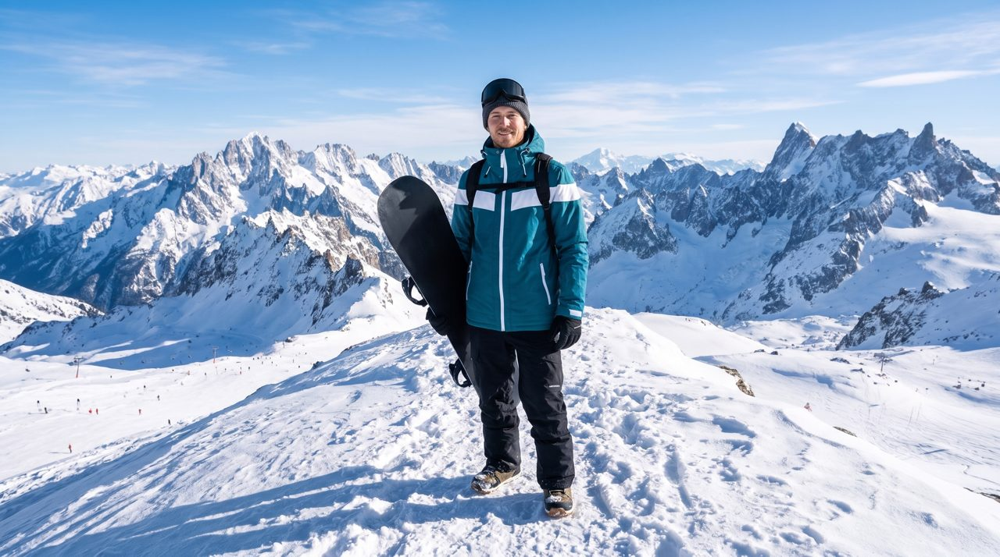
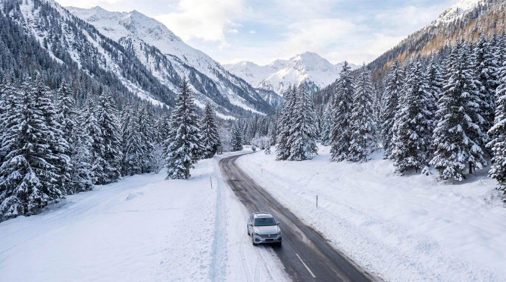
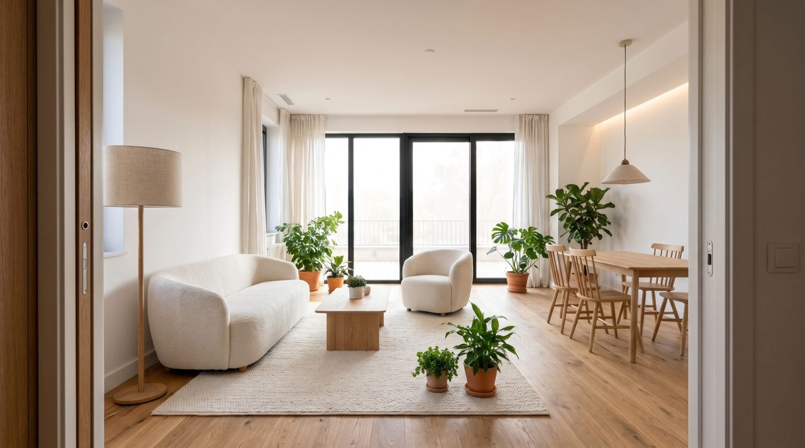

# Lifecast: try it on before you buy anything

> **From that ski jacket to your dream house.** Experience the thrill of buying and using stuff, without actually spending any money.

Lifecast is a Chrome extension plus a web app that turns whatever you're shopping for into a **live, steerable 1080p video of your life with it, starring you**.
Browse a snowboard jacket and you're carving powder in it. Browse a ski resort, then an SUV, and Lifecast remembers both: you get into *that* SUV wearing *that* jacket, drive up the pass, ride the gondola and snowboard down.
At the end you walk through the chalet you'd buy. You drive the video like a game, the shopping page itself works as a controller, and every new website you open hard-cuts the stream to you there.

Built in one day at **Build Day with Live Models (Visko × Google × Reactor), 2026-11-14**, on [Visko Orbis Stable](https://www.reactor.inc/models/visko-orbis-stable)
(real-time, prompt-steerable video + audio over WebRTC), with Gemini 3.5 Flash and Nano Banana Pro (Gemini 3 Pro Image) for planning and keyframes.


| | | |
|---|---|---|
|  |  |  |
| Try-On: the jacket on the ridge | Test drive: the SUV up the pass | Riding Powder Peak |
|  |  |  |
| Walkthrough: staged living room | …same room, furniture moved | Disaster Lab: tsunami scenario |

*These keyframes come from the demo presets, with AI-generated stand-in models. In the product, the same frames are rendered of you from one photo, then animated live by Orbis.*

## Judging criteria, and how Lifecast scores on each

### ⚡ Realtime: you drive it, live
- **One continuous Orbis session for a whole shopping trip**, at 1080p and 18 fps with audio.
- **Game controls generated for each scene.** Gemini writes 5 context-specific inputs (W/A/S/D/Space) for whatever is on screen: surfing gets *Paddle out · Catch wave*, the gondola *Lean · Wipe glass*, the loft *Step forward · Inspect island*. Each set is ready in about 1.3 s and cached.
- **The shopping page is a controller.** Color swatches, car paint, "See it in snow / night", resort "live conditions" and "Try a look" on listings all carry `data-lifecast-prompt`. The extension forwards a click into the stream.
- **Follow mode:** browse to a new site and about 2.5 s later the live stream **hard-cuts** (`set_image`) to you on that page.
- **Chunk-aligned steering**, following the official chunks-and-timing guide: at most one prompt per ~1.8 s chunk, released on `chunk_complete`, newest wins. Auto-cuts wait for the chunk in flight.

| Measured live against Orbis | Result |
|---|---|
| Steer (key / page click) → changed frame on screen | **1.8–3.3 s** (measured to the visible chunk, not the ack) |
| Go live on a warm GPU | **3.3–5 s** |
| New website → live scene of you there | **~5 s** (cut click → first frames) |
| `set_prompt` with `passthrough: true` | **~5 ms** (it hit 10 s timeouts with the server-side rewrite) |
| Cached scene plan / pre-rendered stills | **0.1–0.5 s** / hero + all shots in **~1 s** |
| Output | **1080p · 18 fps**, about $1 per 95 s demo session |

### 🎨 Creativity: it remembers what you want
- **Trend merging.** A Gemini planner reads the current page plus your recent interest history and wardrobe. A jacket + resort + SUV becomes a **journey**: *get in → drive → arrive → lift → ride*, in that jacket, ending at the home you'd buy.
  The car always stays outside; the home is interior-only.
- **Every vertical in one product:** apparel, gear, travel, real estate (walk through and **move the furniture** live) and cars (test-drive on your roads, in any weather).
- **Life-sim game mode:** quests are the journey steps, plus XP, achievements, a wallet with a budget and real prices, an inventory of what you browsed, and random life events every ~45 s ("Golden hour or street rain?").
- **Three directed stories** with distinct shoppers: 🏂 *Powder Day* (jacket → resort → AWD SUV → alpine chalet), 🏄 *Surf Escape* (wetsuit + board → surf town → 4x4 pickup), 🏙 *City Move* (trench coat → brick loft → electric coupe).

### 🛠 Functionality: a real product, end to end
- **Chrome MV3 extension.** It classifies any page from JSON-LD, Open Graph, prices and keywords into apparel / real_estate / auto / travel. It keeps a **private, local** interest history (toggle + clear) and embeds the app in the side panel over a small `postMessage` protocol.
  Clearing your interests also resets the live context.
- **Keyframe-anchored video.** Nano Banana Pro renders identity-consistent stills of you: the hero at 2K, shots at 1K, with your photo, wardrobe and destination as references.
  Every **scene change is a hard image cut** (`reset → set_image → set_prompt → start`), so the video never drifts. Text steering is reserved for small interactive touches, anchored to the scene prompt.
- **Server-side pre-rendering + caches.** Plans, heroes, shots, Orbis prompts and per-scene controls are cached on disk by a stable plan key. A warm-up replays every story exactly like the extension: 64 presets + 14 story pages ≈ 450 images in about 12 min at 10 concurrent jobs. On stage, nothing waits.
- **Resilience fixes, driven by telemetry.** Single-flight cuts (newest queued), a ≤1.5 s conditions grace, `passthrough` + one retry on `set_prompt`, a priming still held until live frames arrive (no black flash), idle auto-disconnect with auto-reconnect on the next page.
- **Profiling everywhere:** server JSONL (every Gemini attempt, per model and fallback), browser telemetry (connect, commands, upload, click → first frames, steer → visible, chunk interval) and a report script.

## How it works
```
 🛍 Browse        🧩 Read              🧠 Plan                 🎨 Keyframes             🎬 Live                 🎮 Play
 any store,  →  extension extracts → Gemini 3.5 Flash    →  Nano Banana Pro       →  Orbis streams it:    →  WASD + page controls,
 listing,       product + your        merges trends into     renders you in it,        set_image cut per        game mode, export
 resort, car    recent interests      a scene + journey      shot by shot (cached)     scene, text steers       your clip
```
More detail: [docs/ARCHITECTURE.md](docs/ARCHITECTURE.md). Demo script: [docs/DEMO.md](docs/DEMO.md). Model research: [docs/RESEARCH_BRIEF.md](docs/RESEARCH_BRIEF.md).

## Also in the app: four live ad studios on the same engine
| Route | Demo | Pitch |
|---|---|---|
| `/tryon` | **Live Try-On**: fashion and snowboard apparel, with realistic snow; upload your photo | Clothing advertising |
| `/staging` | **Live Walkthrough**: upload room photos, stage them, walk through and move the furniture (interior-only rules) | Real estate |
| `/drive` | **Test Drive Anywhere**: any car, any road, any weather | Automotive ads |
| `/disaster` | **Disaster Lab**: natural and man-made disaster timelines on an isometric diorama of any city | Insurance, emergency drills, newsrooms |
| `/omni` (`/lifecast`) | **Lifecast**: the extension app, with game mode | Every product page becomes a test drive |
| `/shop` | Fictional storefronts (7 brand themes) that drive the directed stories | Demo |
| `/pitch` | Pitch page | |

## Run it
Requirements: Node 20.9+, a Reactor API key with Visko Orbis Stable access, and a Gemini API key.
```bash
cp .env.example .env.local     # add REACTOR_API_KEY and GEMINI_API_KEY (optional: SITE_PASSWORD, NEXT_PUBLIC_SITE_URL, CACHE_DIR)
npm install
npm run dev                    # http://localhost:3000; production: npm run build && npm start
```
- **Extension:** run `zip` from `extension/`, or use `public/lifecast-extension.zip`. Then chrome://extensions → Developer mode → **Load unpacked** → `extension/`.
  The panel points at `http://localhost:3000` by default; change it with ⚙.
- **Your photo:** upload it on `/omni`, or place a portrait at `CACHE_DIR/presenter.jpg` to make it the default "You". A fictional stand-in is used otherwise.
- **Pre-render everything** (optional, about 12 min and about $60 of Gemini): open `/omni?admin=1` and click "⚡ Pre-render all", or `POST /api/omni/warm`.
- Orbis bills while connected (~$0.58/min). The app disconnects after 15 idle minutes.

## Tests
- `python3 -I scripts/story_test.py <powder|surf|city> <outdir> [--render]` replays a story exactly as the extension would (plans, journeys, renders).
- `python3 -I scripts/omni_flow_test.py <outdir> [--render]` runs the jacket → resort → SUV flow and checks identity consistency across frames.
- `scripts/e2e/*.cjs` (Playwright): the UI smoke test (no Orbis cost), plus live tests for realtime steering, context controls, follow-mode cuts, auto-cuts and context reset.
  Set `BASE_URL` and `SITE_PASSWORD` (if any).
- `scripts/profile_run.sh` + `scripts/profile_report.py` cover profiling. `scripts/gen_assets.py` regenerates the fictional product photos.

## Repo map
| Path | What |
|---|---|
| `extension/` | Chrome MV3 extension (content classifier, local history, side panel bridge) |
| `lib/demos.ts`, `lib/shop.ts` | Demo content (subjects, options, chips, shots, scenarios) and storefront data (products, stays, homes, cars, stories) |
| `lib/server/omni.ts` | Lifecast planner: verticals, trend merging, journey mode, plan cache |
| `lib/server/{render,prerender,warm,controls,gemini}.ts` | Keyframe rendering, pre-render + warm-up, per-scene controls, Gemini clients with model fallback |
| `hooks/use-orbis-studio.ts` | Orbis session engine: cuts, chunk-aligned steering, latency measurement, telemetry |
| `components/studio.tsx`, `components/omni.tsx`, `components/life-sim.tsx` | Studio UI with controller and auto demo; Lifecast app and follow mode; game HUD |
| `app/shop/*`, `app/pitch/*` | Storefronts and pitch page |

Built on the [Visko Orbis hackathon starter](https://github.com/Visko-Platform/orbis-online-hackathon-starter) (token minting, WebRTC player, dev session cleanup).
All brands, products and people in the assets are fictional and AI-generated.
